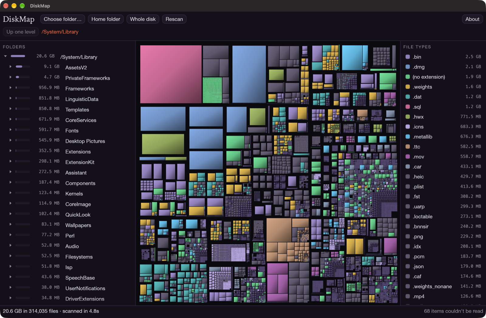

# Disk Map

See what's using your Mac's disk. Disk Map scans a folder, or your whole disk, and draws every file as a rectangle sized by the space it takes, in the style of WinDirStat on Windows.



## Features

- **Fast scans.** Scanning runs on every CPU core. It counts the space files actually use on disk, so iCloud files that aren't downloaded count as zero and hard-linked files count once.
- **Treemap.** Every file is a shaded block, coloured by file type. Hover for details, click to select, and double-click a folder to zoom in.
- **Folder list.** Folders are sorted largest first, with a bar showing each one's share of its parent.
- **File types.** Click a type to highlight those files on the map, or hide every other type to see only that one.
- **"What is this?"** Disk Map recognises common space hogs, such as Xcode DerivedData, `node_modules`, caches and iPhone backups. It explains each one and says whether it's safe to delete. For anything else, it can open a pre-written question in Claude or a Google search.
- **Clean up.** Right-click anything to reveal it in Finder, move it to the Trash (Finder's Put Back still works), or delete it permanently. Each one asks for confirmation first. Disk Map won't delete your home folder, macOS system folders, or folders macOS expects to exist, such as Documents and Library.
- **Full Disk Access check.** macOS hides some folders, such as Mail, Messages and Safari, until you allow Full Disk Access. Disk Map tells you when it's off and opens the right page in System Settings.

## Requirements

- macOS 12 or later (it's developed on Apple Silicon)
- [Rust](https://rustup.rs) 1.95 or later, to build it

## Build and run

```sh
git clone https://github.com/theheadgeek/DiskMap.git
cd DiskMap
cargo run --release                  # opens the start screen
cargo run --release -- ~/Downloads   # starts scanning a folder straight away
```

To build a standalone `DiskMap.app`:

```sh
./scripts/make-app.sh             # builds target/release/DiskMap.app
./scripts/make-app.sh --install   # also copies it to /Applications
```

The app is signed locally ("ad hoc"), not with an Apple Developer certificate. If macOS blocks it on another Mac, right-click it in Finder and choose **Open**.

## Seeing every folder

For a complete scan, turn on Full Disk Access: open **System Settings → Privacy & Security → Full Disk Access** and switch on **DiskMap**. If you run Disk Map from a terminal instead, switch on the terminal app, such as Terminal or Visual Studio Code. Then quit and reopen the app.

On a Mac this does the job of "Run as administrator", and `sudo` doesn't get around it. Disk Map shows these steps and a button that opens the right Settings page.

## Privacy

Disk Map never sends anything over the internet by itself. The only time it opens a web page is when you choose **What is this? → Ask Claude** or **Search Google**. Those send the item's name and path, with your home folder shortened to `~`, to claude.ai or Google.

## How it's built

Disk Map is written in Rust using [egui](https://github.com/emilk/egui) for the window and [rayon](https://github.com/rayon-rs/rayon) for parallel scanning.

| File | What it does |
| --- | --- |
| `src/scan.rs` | Walks the disk in parallel and builds the tree of sizes |
| `src/treemap.rs` | Squarified treemap layout (Bruls, Huizing & van Wijk, 2000) |
| `src/app.rs` | The window: toolbar, folder list, map, file types and dialogs |
| `src/known.rs` | The built-in descriptions of common folders |
| `src/files.rs` | Trash, delete, safety checks and web lookups |
| `src/access.rs` | Full Disk Access detection |
| `src/theme.rs` | Colours and type, from the Inactive Node design system |
| `src/brand.rs` | The Inactive Node mark and copyright line |

Run the tests with `cargo test`.

Contributions are welcome, especially new entries for `src/known.rs`.

## License

MIT. See [LICENSE](LICENSE).

Copyright © 2026, Inactive Node
